# Mika design refresh

Screenshots of every major screen, captured from the running app with `capture-screenshots.cjs`.

| Folder | Setup |
| --- | --- |
| `screenshots/before/` | Desktop, before the refresh (state of `main` after the accessibility patch) |
| `screenshots/desktop/` | Desktop 1440x900, light |
| `screenshots/desktop-dark/` | Desktop 1440x900, dark (follows the system setting) |
| `screenshots/mobile/` | Phone 390x844, light |

## Before and after

| Before | After |
| --- | --- |
| 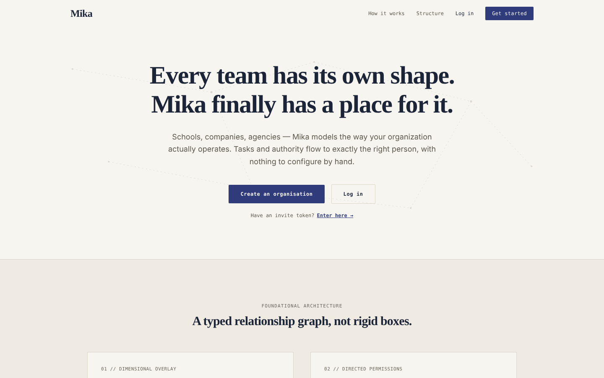 | 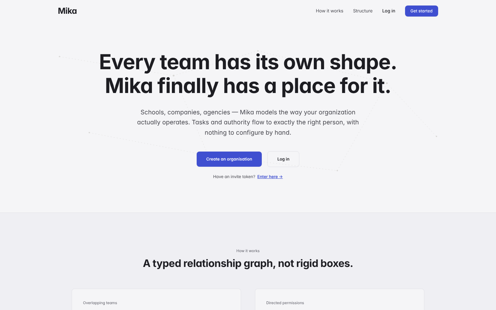 |
| 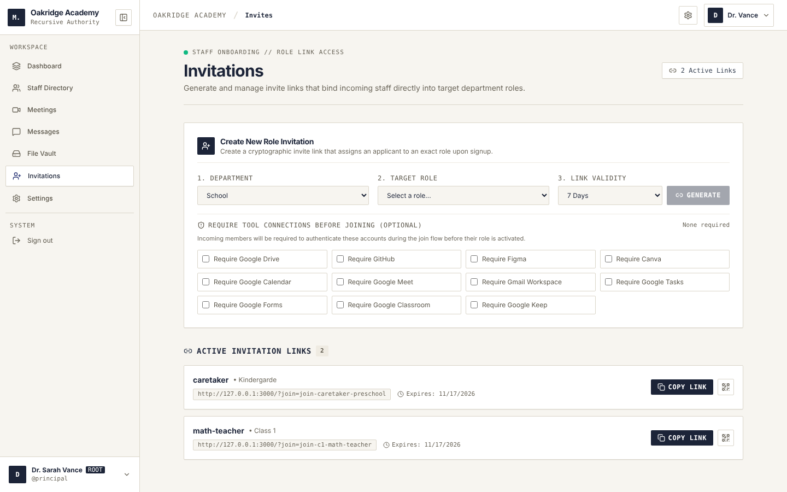 | 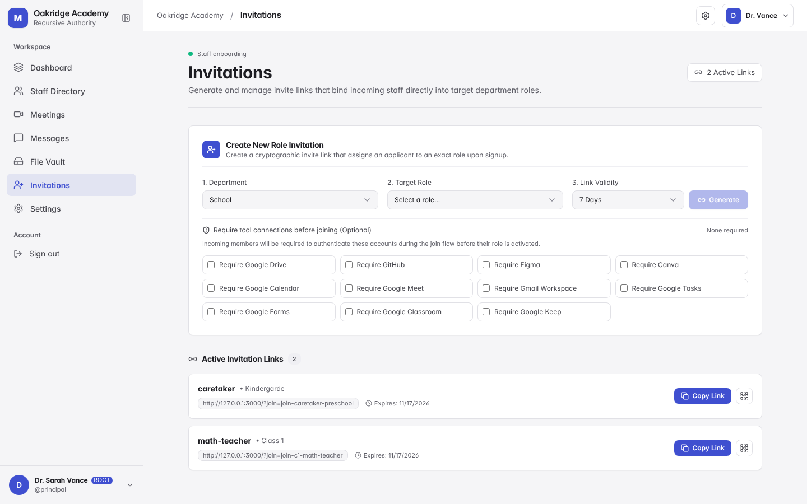 |
| 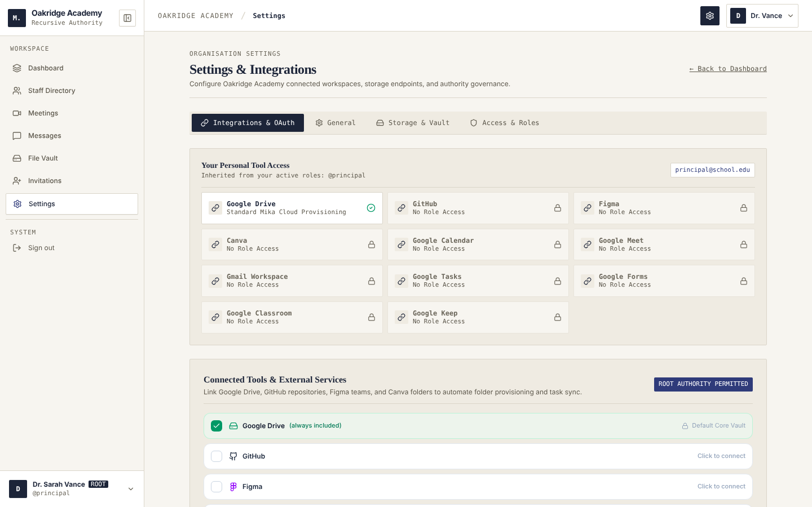 | 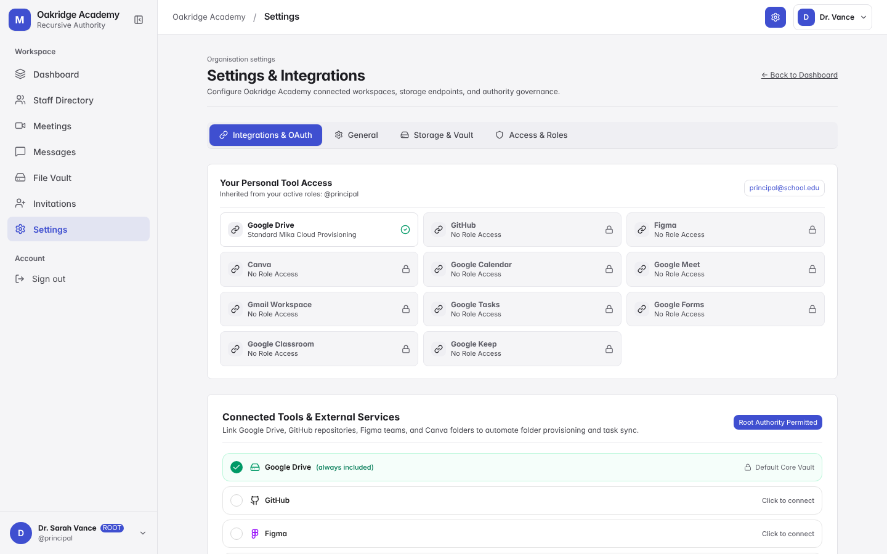 |
| 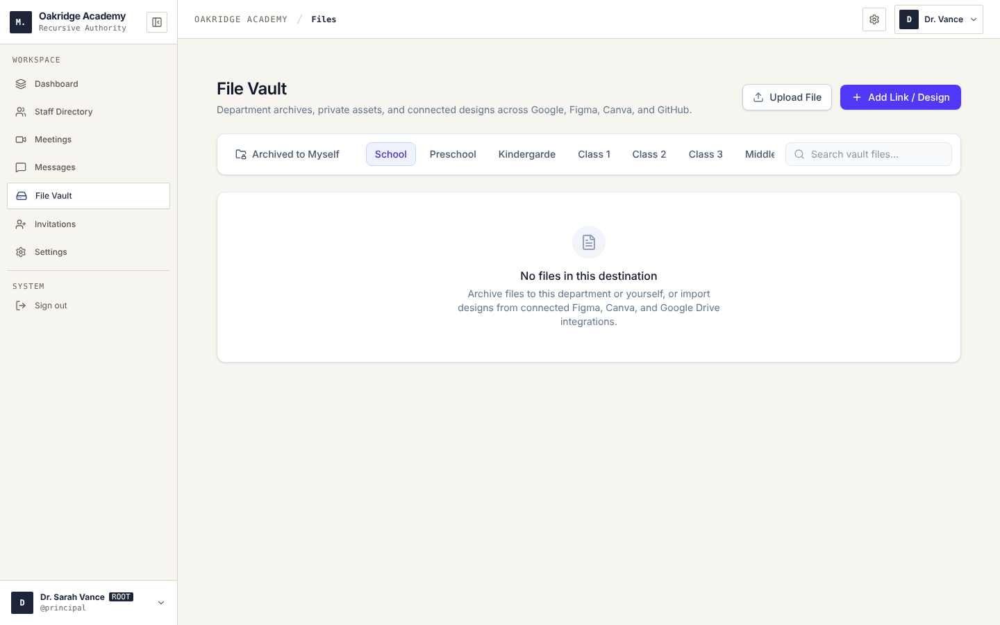 | 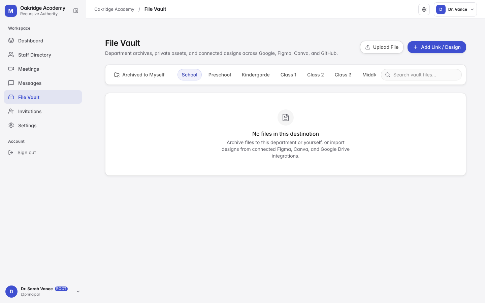 |

## Phone

| Navigation drawer | Staff directory | Messages | Task detail |
| --- | --- | --- | --- |
| 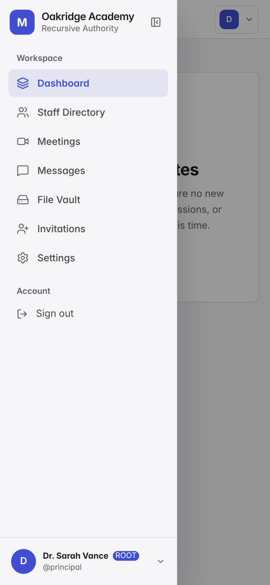 | 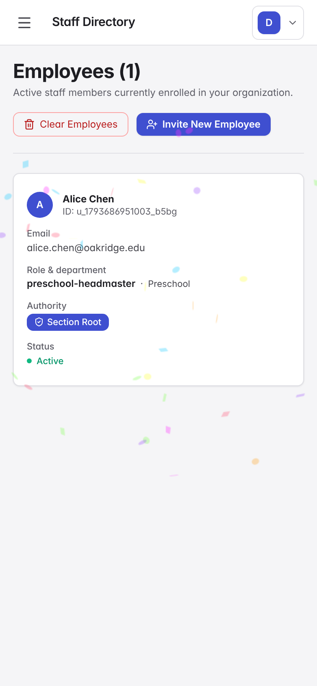 | 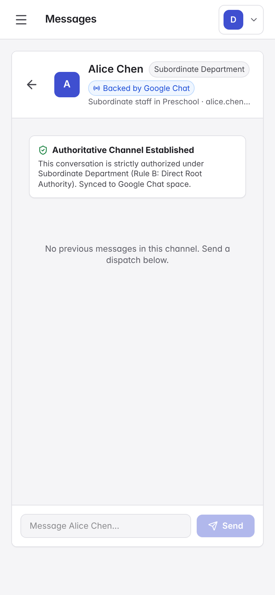 | 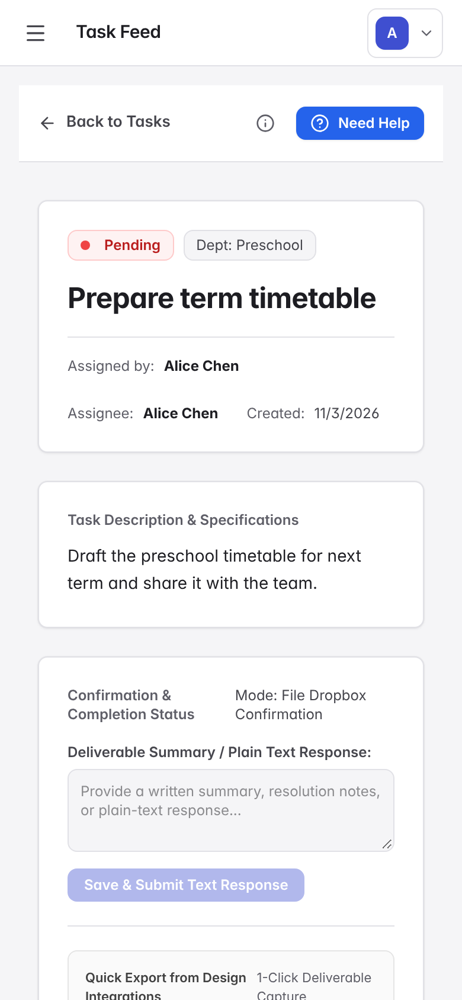 |

## Regenerating

```bash
npm run dev                                   # in one terminal (serves http://localhost:3000)
npm i -D playwright && npx playwright install chromium   # once
node docs/design/capture-screenshots.cjs                  # writes docs/design/screenshots/
```

The script drives the real flows (sign out, simulate an employee joining, switch to that employee, assign a task),
so the empty states, populated states, modals and the full-page task view are all captured.

## What the refresh covers

- One accent (indigo) and calm neutral surfaces in light and dark; every text and background pair is at least 4.5:1.
- One type voice: the system UI font (SF Pro on Apple devices, Inter elsewhere). Monospace is reserved for real code (`.font-code`).
- Sentence-case labels, plain-language section names, status names instead of colour names on the task filters.
- Softer shape and depth: larger radii, layered shadows, accent-tinted selection.
- Phones get a top bar and a slide-over navigation drawer; Messages is list-then-conversation; the staff table becomes cards.
